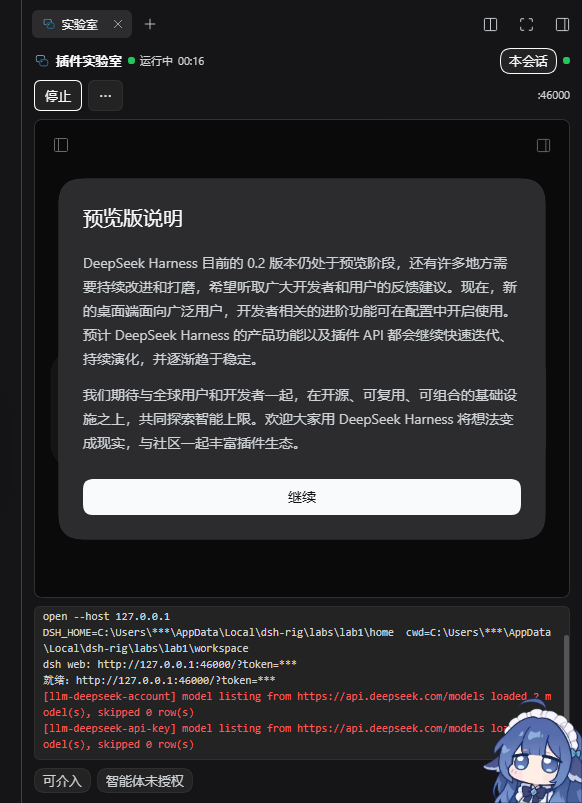
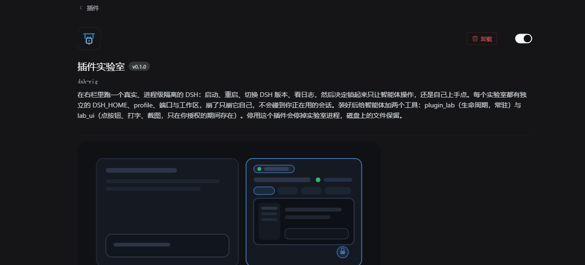

# dsh-rig

A **right-sidebar plugin lab** for [DeepSeek Harness](https://github.com/deepseek-ai/deepseek-harness): run a real, process-isolated DSH beside your conversation — install plugins into it, watch its logs, switch versions, and know that a crash stays inside the lab.

[中文](README.md) · [Changelog](CHANGELOG.md)



## Why

When you develop a DSH plugin, the painful part is that **there is nowhere safe to break things**. The convenient move is to mount the plugin into the profile you are actually using — and one bad `apply()` takes the whole harness down with it.

dsh-rig gives you a test bench:

- the lab is **another process**, with its own `DSH_HOME`, profile, port and workspace;
- if it crashes, or its dependency tree gets mangled, it stays there (the host's dependency closure was measured unchanged);
- the panel lives in the right sidebar: state, logs, restart and a health report in one place.



## Install

```bash
dsh plugin --profile web add dsh-rig
```

Or from the app: **Plugins → Add plugin → dsh-rig**.

Reload the page afterwards: the right sidebar's start page gains a **Plugin Lab** card (hand-drawn icon — two offset windows, because the point is that something real is nested inside the panel).

## Use

1. Open the **Plugin Lab** card → **Create lab**;
2. **Start** — a real DSH comes up in about ten seconds, embedded right there;
3. Click into it straight away (unlocked by default). Hit **Locked** at the bottom when you only want to watch;
4. **⋯** holds the rest: restart / refresh / pop out / switch version / isolation notes / destroy (destroy asks twice);
5. **Logs · N** expands the console tail, with tokens and user names redacted.

**The right sidebar opens itself the first time an agent drives the lab**, so you never go looking for it. Once per session.

### Occupancy: the lab is global, the panel is per-session

One lab can be on screen in two sessions at once. The only rule: **you claim it by acting**, not by opening the panel.

| State | Header chip | Primary button | Viewport |
|---|---|---|---|
| This session drives it | `this session` | Start / Stop | clickable |
| Another session drives it | `session a1b2c3d4 · since 18:20` | only **Take over** | **still visible**, input blocked |
| Nobody drives it | `idle` | Start | clickable |

Only the first 8 characters of a session id are shown — titles can be private. Taking over interrupts whatever the other session was doing.

Labs live under the application data directory (`%LOCALAPPDATA%\dsh-rig` on Windows), one folder per lab with `home/` (DSH_HOME), `workspace/` and `shots/`.

## How isolated is it

| Layer | Covered | Not covered |
|---|---|---|
| Process | separate process, crash containment, own port | — |
| DSH data | own `DSH_HOME` (credentials, sessions, profile, plugins) | — |
| Filesystem | `workspace-write` by default, cwd pinned to the lab workspace | does not stop the lab's agent from touching files its permission allows |
| Kernel | — | Home-edition Windows has no Sandbox/Hyper-V, so this is not VM-level isolation |
| Input | lock blocks mouse and keyboard | does not block the lab's own agent; this is not a security boundary |

## Agent tools

Two tools are added:

| Tool | Available | Does |
|---|---|---|
| `plugin_lab` | always | `list / create / start / stop / restart / destroy / status / logs / report / versions / set_version / orphans / reap` |
| `lab_ui` | **only while you allow it** | `snapshot / screenshot / click / type / task` — finds buttons **by their text** and lists candidates when it cannot |

Both tools obey occupancy: while another session drives the lab they **refuse** and name the owner,
unless you pass `force: true` to take over (which interrupts the other session's work).

`lab_ui` is not resident: a tool schema costs context every turn, and most sessions never click anything. So it sits behind a permission — the panel's "Let the agent operate the UI" switch registers it, and turning the switch off unregisters it.

The UI backend degrades by availability, and **assumes no browser**:

1. Playwright with its own browser;
2. Playwright driving the system Edge/Chrome (no download);
3. Raw CDP against any installed Chromium-based browser (zero npm dependencies);
4. Otherwise it says exactly what is missing.

## Health report (`report`)

Being able to *see* is worth more than being able to *click*. `report` returns blocks, each with its own evidence source:

- **declared** — bundles the profile declares;
- **patched** — rows in the composition patch;
- **runtime** — status, port, exit code;
- **logFacts** — plugin rows denied or failed at startup;
- **workspace** — workspace file tree.

Anything unreadable is reported as unreadable with a reason — never an empty array pretending to be "none".

## Configuration

| Field | Default | Meaning |
|---|---|---|
| `labRoot` | `dsh-rig` under app data | Lab root; **must not contain or sit inside the host `DSH_HOME`**, otherwise creation is refused |
| `copyCredentials` | `true` | Copy the host `.credentials.yaml` into the lab (without it the lab's agent has no model) |
| `maxLabs` | `8` | Concurrent labs |
| `startTimeoutMs` | `60000` | How long to wait for HTTP readiness |
| `logRingLines` | `2000` | Log lines kept per lab |
| `uiBackend` | `auto` | `auto / playwright / cdp`; also `DSH_RIG_UI_BACKEND` |

## Known limits

- Switching DSH versions works only for **already installed** versions (no installer yet).
- "Dispatch a task into the lab" and progress visualisation are not built yet — for now you type in the unlocked view, or let the agent drive `lab_ui`.
- The headless browser opens a local debugging port. It lives only while the lab runs and only while you allow it, but that is the inherent cost of the simulate-a-human path.

## License

Apache-2.0. See [LICENSE](LICENSE) and [NOTICE](NOTICE).
