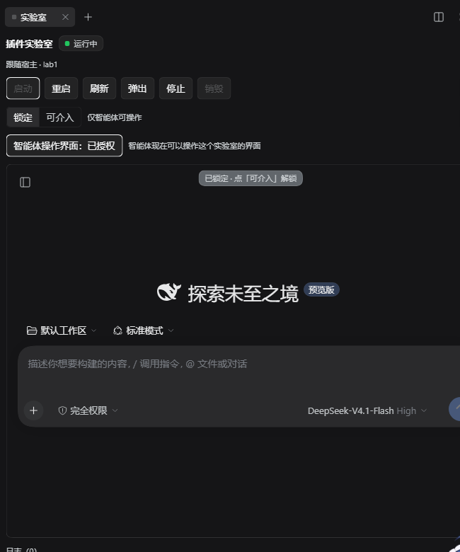
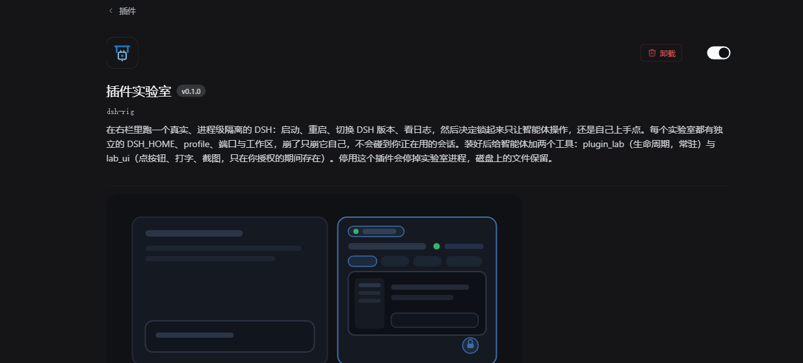

# dsh-rig

给 [DeepSeek Harness](https://github.com/deepseek-ai/deepseek-harness) 的**右栏插件实验室**：建一个隔离的 DSH 实例，启动后在**右侧栏的浏览器标签里直接使用它** —— 装插件、看日志、点界面，崩了不牵连你正在用的这个。

[English](README.en.md) · [更新日志](CHANGELOG.md)



## 它解决什么

开发 DSH 插件时，最难受的是**没有一块可以随便弄坏的地方**：图省事把插件挂进自己在用的 profile，一次坏的 `apply()` 就把整个 harness 拖下去。

dsh-rig 给你一块试验台：

- 实验室是**另一个进程**，有自己的 `DSH_HOME`、profile、端口和工作区；
- 它崩了、它的依赖树乱了，都只发生在它自己身上（宿主依赖闭包实测零变化）；
- 面板就在右栏，状态、日志、重启、体检都在一处。



## 装

```bash
dsh plugin --profile web add dsh-rig
```

或在 DSH 里：**插件 → 添加插件 → dsh-rig**。

装完刷新页面，右栏开始页会多一张「插件实验室」卡片（图标是自绘的双层窗口：面板里套着一个真东西）。

## 用

1. 点右栏「插件实验室」→「创建实验室」；
2. 「启动」：起一个真实 DSH（十秒左右到「运行中」），右栏里直接嵌着它的界面；
3. 直接在里面点就行（默认**不锁**）。只想看着、怕手滑时点底部「已锁定」；
4. 「⋯」里是其余动作：重启 / 刷新 / 弹出到窗口 / 切换版本 / 关于隔离边界 / 销毁（销毁要二次确认）；
5. 底部「日志 · N」展开控制台尾巴，token 与用户名自动打码。

**智能体第一次用实验室时，右栏会自己展开到这一页**，不用你去找。同一个会话只抢一次焦点。

### 占用：实验室是全局的，面板是会话级的

同一个实验室可能被两个会话同时看着（右栏面板属于会话，实验室属于宿主）。规则只有一条：**动手才占坑**，打开面板不算。

| 情况 | 头带 | 主按钮 | 视口 |
|---|---|---|---|
| 本会话在驾驶 | `本会话` | 启动 / 停止 | 可点 |
| 别的会话在驾驶 | `DSH 插件实验室开发规划 · 18:20 起` | 只剩「接手」 | **照样给你看**，只挡输入 |
| 没人驾驶 | `空闲` | 启动 | 可点 |

占用者显示**会话标题**（和左侧栏列表里那份是同一个），标题随对话变了这里也跟着变；拿不到标题才退回 id 前 8 位，完整 id 在鼠标悬停里。「接手」会中断对方正在进行的操作。


实验室默认落在 `%LOCALAPPDATA%\dsh-rig\`（Windows）、`$XDG_DATA_HOME/dsh-rig`（macOS / Linux，缺省 `~/.local/share/dsh-rig`），
每个实验室一份 `home/`（DSH_HOME）、`workspace/`、`shots/`。

## 隔离到什么程度

| 层 | 做到 | 没做到 |
|---|---|---|
| 进程 | 独立进程、崩溃不连坐、独立端口 | — |
| DSH 数据 | 独立 `DSH_HOME`（凭据、会话、profile、依赖全隔离） | — |
| 文件系统 | 默认 `workspace-write`，cwd 锁在实验室工作区 | 不防实验室里的智能体按它的权限读写你机器别处 |
| 内核 | — | 家庭版 Windows 没有 Sandbox / Hyper-V，所以不是虚拟机级隔离 |
| 输入 | 锁定态挡鼠标键盘 | 挡不住实验室自己的智能体；这不是安全边界 |

## 工具面

装好后，智能体多两个工具：

| 工具 | 什么时候在 | 干什么 |
|---|---|---|
| `plugin_lab` | 常驻 | `list / create / start / stop / restart / destroy / status / logs / report / versions / set_version / orphans / reap` |
| `lab_ui` | **只在你授权期间** | `snapshot / screenshot / click / type / task` —— 按**文字**找按钮，找不到会把候选名列出来 |

两个工具都受占用约束：实验室被别的会话驾驶时，它们会**拒绝**并说出占用者 id，
除非显式传 `force: true` 接手（那会中断对方正在进行的操作）。

`lab_ui` 不是常驻的：工具 schema 每轮都进上下文，而大多数时候用不到「点按钮」。
所以它挂在权限后面——面板里打开「智能体操作界面」才注册，关掉即注销。

界面驱动的后端按可用性降级，**不假设你机器上有浏览器**：

1. Playwright（自带浏览器）；
2. Playwright 借用系统 Edge/Chrome（不下载）；
3. 裸 CDP 直连系统 Chromium 系浏览器（零 npm 依赖）；
4. 都没有就明说缺什么。

## 体检（`report`）

比「能点」更值钱的是「看得清」。`report` 给出一份分块报告，每块有各自的证据来源：

- **declared**：profile 声明了哪些 bundle；
- **patched**：组合补丁里的行；
- **runtime**：状态、端口、退出码；
- **logFacts**：启动期被版本闸门禁用或加载失败的插件行；
- **workspace**：工作区文件树。

读不到就写「读不到」加原因，不拿空数组冒充「没有」。

## 配置

| 字段 | 默认 | 说明 |
|---|---|---|
| `labRoot` | 应用数据目录下的 `dsh-rig` | 实验室根目录；**必须与宿主 `DSH_HOME` 互不包含**，否则拒绝创建 |
| `copyCredentials` | `true` | 把宿主 `.credentials.yaml` 复制进实验室（否则实验室里的智能体没有可用模型） |
| `maxLabs` | `8` | 同时存在的实验室上限 |
| `startTimeoutMs` | `60000` | 等 HTTP 就绪的上限 |
| `logRingLines` | `2000` | 每个实验室保留的日志行数 |
| `uiBackend` | `auto` | `auto / playwright / cdp`；也可用环境变量 `DSH_RIG_UI_BACKEND` |

## 已知边界

- 换 DSH 版本目前只能切到**已装**的版本（安装新版本的入口还没做）。
- 「派活给实验室里的智能体」与「施工过程可视化」还没做——现在靠你在解锁态下自己输入，或让智能体用 `lab_ui` 去点。
- 无头浏览器会开一个本地调试端口；它随实验室起停、只在授权期间存在，但这是「模拟点击」这条路的固有代价。
- **0.2.0 起实验室跑成第二个桌面实例**：同一个可执行文件，独立 `--user-data-dir` 与 `DSH_HOME`。
  代价是**多一个窗口和一个托盘图标**；那个窗口关掉不代表进程退出，判定以面板上的状态为准（要停就在面板点「停止」）。
  为什么不做 web / desktop 开关：两条完整的代码路各自要维护与验收，而「宿主是不是桌面版」本来就是客观事实，让用户选只会选错。
- **macOS 上默认路线不需要任何系统授权**：帧是实验室自己渲染的（`capturePage`），输入走进程内注入（`sendInputEvent`），
  都不碰屏幕录制与辅助功能。真被要求授权，说明走的是备用路线；授权后要**退出实验室再启动**才生效，
  拒绝的表现是全黑帧而不是报错。逐平台细节见 [docs/PLATFORMS.md](docs/PLATFORMS.md)。
- **Linux 无图形会话**（SSH 登录、`DISPLAY` 与 `WAYLAND_DISPLAY` 都空）：实验室照常起，画面走右栏「浏览器」标签
  （那里退回 iframe 载体；同一个宿主的 iframe 与实验室同站，登录态正常）。
  这是兜底，不是选项——「有没有屏幕」是客观事实，做成开关只会出现必然失败的组合。
  Wayland 下不依赖 portal，所以不会弹「允许共享屏幕」；代价是抓不到实验室窗口以外的任何东西（我们不需要）。
- 桌面版与 web 版同时开着时共用同一份 `labs.json`。0.1.5 起写盘带锁并**读盘合并**：
  盘上有的、内存里没有的记录留着，不会被这一端写没。
  0.1.6 起「这条归谁」的判据是 **pid 存活**（活着、且不是本进程或它的子进程 → 别的宿主在跑它，面板里只读）。
  为什么不再用 `hostId`：0.1.5 的 `hostId` 是每进程随机的，宿主一重启身份就变了，
  自己上次建的实验室全被判成别人的，锁死成只读。

## 许可

Apache-2.0，见 [LICENSE](LICENSE) 与 [NOTICE](NOTICE)。
